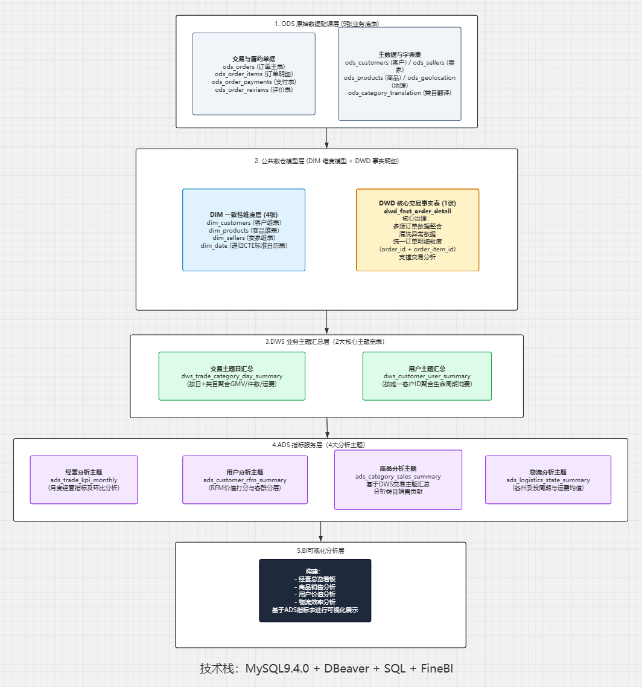
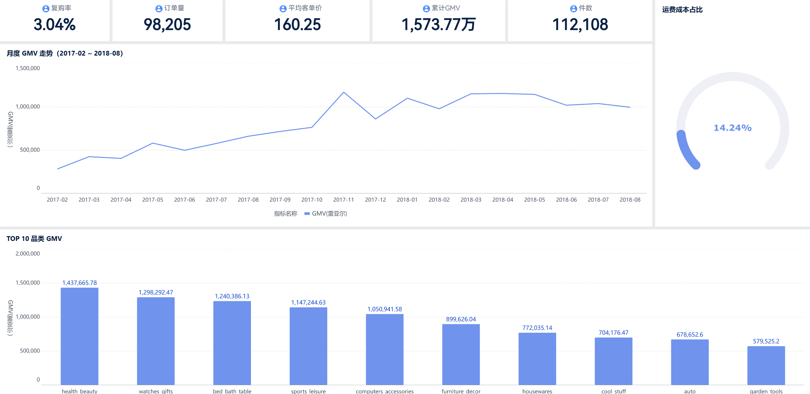
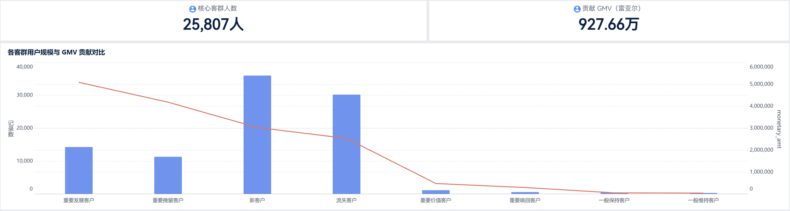
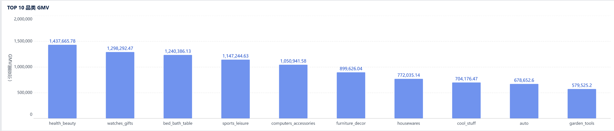
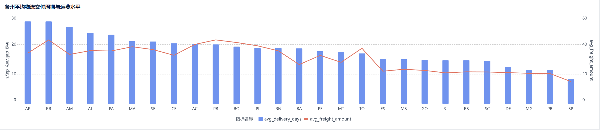

# Olist 电商数据仓库建设与经营分析

基于 Olist 巴西电商公开数据集（9.9 万订单 / 11.2 万条明细），用 MySQL 按 ODS–DIM–DWD–DWS–ADS 五层建模并落地 **20 张表**，完成从数仓建模、指标计算到 FineBI 看板与经营分析的全链路；核心产出是定位出「复购率仅 3.04%」的真实成因并给出可测算的运营方案。

---

## 关键结论

| # | 结论 | 关键数字 |
|---|---|---|
| 1 | 规模见顶：2018 年下半年月度 GMV 增速明显趋平，粗放拉新已到天花板 | 累计 GMV **1,573.77 万**雷亚尔 · 订单 **98,205** 笔 · 客单价 **160.25** |
| 2 | 复购极低，且被观察窗口系统性低估 | 全周期复购率 **3.04%**（2,887 / 94,989）；2017 首单客群 4.23%、2018 客群仅 2.04% |
| 3 | 二八分布极度显著，但客群资产脆弱 | **25,807** 名高价值客群贡献 **927.66 万 GMV，占大盘 58.9%** |
| 4 | 履约时效与复购呈稳定负相关（控制观察窗口后） | 妥投 ≤7 天复购 **4.50%** → >21 天 **3.32%**，相对衰减 **26.2%** |
| 5 | 运费侵蚀利润，且品类两极分化 | 运费占 GMV **14.24%**；`relogios_presentes` 仅 8.4%，`moveis_decoracao` 达 23.7% |
| 6 | 补贴方案有条件成立，对抽佣假设高度敏感 | 净佣金收益 **5,035** 元 / ROI **20.19%** / 盈亏平衡佣金率 **12.48%** |

---

## 项目概览

| 项目 | 内容 |
|---|---|
| 数据规模 | 98,018 笔订单 · 112,650 条订单商品明细 · 94,989 名买家 · 时间窗 2016-09 ~ 2018-08 |
| 技术栈 | MySQL 8 · SQL · DBeaver · FineBI |
| 数仓分层 | ODS(9) → DIM(4) → DWD(1) → DWS(2) → ADS(4)，共 **20 张表** |
| 建模方法 | 星型模型：代理键 + 退化维度 + 可加性度量 |
| 分析方法 | RFM 均值阈值分群、双轴对比、分箱归因、增量收益测算与敏感性分析 |
| 交付物 | SQL 脚本 20 个（ODS 表结构 + 分层加工）· FineBI 看板 4 套 · 经营分析 PPT |

---

## 数仓架构



```text
Olist 原始 CSV
      ↓
ODS  原始数据层（9 表，字段原样落地，不做类型转换）
      ↓
DIM  公共维度层（4 表） +  DWD 明细事实层（1 表，星型模型）
      ↓
DWS  业务主题汇总层（2 表：交易 / 客户）
      ↓
ADS  指标应用层（4 表：经营 / RFM / 品类 / 物流）
      ↓
FineBI 看板  →  经营分析结论
```

**为什么这样分层**：每一层只做一件事——ODS 保证不丢数据、可回溯；DIM 统一描述口径；DWD 把数据变干净并固定粒度；DWS 把重复计算收敛成指标；ADS 直接服务报表。口径变更时只需改 DWS/ADS 一层，不用重做全部图表。

---

## 分层与表设计

### ODS · 原始数据层（9 表）

`ods_orders` · `ods_order_items` · `ods_order_payments` · `ods_order_reviews` · `ods_customers` · `ods_products` · `ods_sellers` · `ods_geolocation` · `ods_category_translation`

**说明**：Kaggle 原始 CSV **直接导入，未做任何字段加工**；时间字段保持字符串类型，未强制转换。所有类型转换与脏值处理统一在 DWD 层完成（用 `NULLIF(col,'')` 兜底空字符串）。

> `SQL/ODS/` 下的 9 个脚本是**导入后的表结构**，目的是让库结构可复现，不含加工逻辑——ODS 层的职责就是「原样保存」，不需要额外处理。

### DIM · 公共维度层（4 表）

| 表 | 说明 |
|---|---|
| `dim_customers` | 客户维度，`customer_unique_id` 为业务键，`customer_sk` 为代理键 |
| `dim_products` | 商品维度 + 品类英文名翻译 |
| `dim_sellers` | 商家维度 |
| `dim_date` | 日期维度（1,461 天，支持按月/按周聚合） |

### DWD · 明细事实层（1 表）

`dwd_fact_order_detail` —— 订单明细事实表，**粒度 = 一笔订单里的一个商品**（`order_id + order_item_id`）。

| 设计要素 | 字段 |
|---|---|
| 代理键（外键连线） | `customer_sk` · `product_sk` · `seller_sk` |
| 退化维度 | `order_id` · `order_item_id` · `order_status` |
| 可加性度量 | `price` · `freight_value` · `total_amount` |
| 业务时间 | 下单 / 收货 / 预计送达 |
| 技术字段 | `etl_time` |

> 粒度是这一层最关键的约定：一行代表一个商品，因此按订单计数必须 `COUNT(DISTINCT order_id)`，否则一单多件会重复计数。

### DWS · 业务主题汇总层（2 表）

| 表 | 粒度 | 主要指标 |
|---|---|---|
| `dws_trade_category_day_summary` | 日期 × 品类 | GMV、订单数、销量、运费 |
| `dws_customer_user_summary` | 一人一行（`customer_unique_id`） | 首末单时间、总单量、总件数、累计消费、客单价、是否复购 |

### ADS · 指标应用层（4 表）

| 表 | 用途 |
|---|---|
| `ads_trade_kpi_monthly` | 月度经营大盘：GMV、订单、件数、客单价、环比、运费率 |
| `ads_customer_rfm_summary` | RFM 客户分层（R/F/M 各按均值打 0/1 分，组合成 8 象限） |
| `ads_category_sales_summary` | 品类销售贡献与占比 |
| `ads_logistics_state_summary` | 各州平均交付天数与平均运费 |

---

## 口径说明

口径是这份分析里最容易出错的地方，这里显式写清：

| 指标 | 口径 |
|---|---|
| **GMV** | `SUM(total_amount)`，即**商品金额 + 运费**；只剔除 `canceled` 状态的 461 单，其余状态（含 shipped / processing）均计入。合计 **15,737,667.52** |
| **客单价 AOV** | GMV ÷ 订单数 = **160.25**（加权口径，不是把 12 个月的月度客单价再平均一次） |
| **复购率** | 下单 ≥2 次的买家 ÷ 全部买家 = 2,887 ÷ 94,989 = **3.04%**；按 `customer_unique_id` 去重（Olist 里同一自然人会有多个 `customer_id`） |
| **运费占 GMV** | 加权值 = 2,241,259.09 ÷ 15,737,667.52 = **14.24%**。注意不能把月度百分比直接 `AVG()` 平均 |
| **复购分箱** | 按**首单**妥投天数分箱，且只取「首单在 2017 年」的客群，规避观察窗口截断 |

---

## 关键分析发现

### 1. 整体经营：规模见顶

月度 GMV 在 2017-11 达到峰值（117.2 万），2018 年虽有 110~115 万的高位，但**环比增速已趋平**，靠拉新驱动的增长模式接近天花板。

### 2. 复购率低，且被观察窗口截断低估

二次购买的平均间隔是 **81 天**，50.6% 在 30 天内、**68% 在 90 天内**。而数据截止 2018-08，2018 年首单的 51,668 名买家（占全部买家 **54%**）观察期不足 90 天，会把复购率稀释掉：

- 2017 首单客群复购 **4.23%**
- 2018 首单客群复购 **2.04%**

因此分箱分析统一取「首单在 2017 年、观察期 ≥8 个月」的客群。

### 3. 客户价值：二八极度显著，但资产结构脆弱

用 R/F/M 三项与整体均值比较打 0/1 分，组合成 8 个象限。其中「重要发展 + 重要挽留」合计 **25,807 人**，贡献 **927.66 万 GMV（占大盘 58.9%）**。

但这批高价值客户多数只有 1~2 次购买记录，主要靠单次大额客单支撑——需求方一旦流失，很难靠频次补回来。

### 4. 履约归因：时效与复购稳定负相关

| 首单妥投天数 | ≤7 天 | 8–14 天 | 15–21 天 | >21 天 |
|---|---|---|---|---|
| 复购率 | **4.50%** | 4.22% | 4.08% | **3.32%** |

单调下降，相对衰减 **26.2%**。背后是明显的区域鸿沟：

| 州 | 妥投单量 | 平均交付 | 平均运费 |
|---|---|---|---|
| SP（圣保罗） | 40,494 | **8.3 天** | **15.11** |
| RR / AP（北部偏远） | 41 / 67 | **27.8 天** | 43.09 / 34.16 |

时效相差 3.3 倍、运费相差 2.3 倍。平台商家集中于圣保罗，跨区长途的高运费与长等待，正是非核心区复购偏低的结构性原因。

### 5. 品类：轻件现金牛 vs 重货泥潭

| 品类 | GMV 排名 | 运费占自身 GMV |
|---|---|---|
| `relogios_presentes`（手表礼品） | **第 2** | **8.4%（最低）** |
| `cama_mesa_banho`（家纺） | 第 3 | 19.7% |
| `moveis_decoracao`（家具装饰） | 第 6 | **23.7%（最高）** |

体积小、货值高的轻件是健康现金牛；大件抛货的长途运费直接吃掉毛利。

### 6. 财务测算：补贴方案有条件成立

以东南核心圈 62,328 名买家为基数，假设复购率从 3% 提升到 5%（ΔR=2%）：

| 环节 | 数值 |
|---|---|
| 增量订单 | 1,247 单 |
| 新增 GMV | 199,831.75 元 |
| 营销补贴（20 元/单） | 24,940 元 |
| 新增佣金（15%） | 29,974.76 元 |
| 净收益 | **5,034.76 元** |
| 补贴撬动比 ROAS | 8.01×（流水口径，**不能**判断盈亏） |
| 净利润回报率 ROI | **20.19%**（利润口径） |
| **盈亏平衡佣金率** | **12.48%** |

基准假设 15% 只比盈亏线高 2.5 个百分点——说明方案对抽佣口径高度敏感，建议先以 5%~10% 流量做 A/B 验证 ΔR 是否可达，再决定放量。

---

## BI 可视化看板

### 1. 经营分析驾驶舱



累计 GMV · 订单量 · 件数 · 客单价 · 月度 GMV 趋势与环比

### 2. 用户价值分析



客群规模与 GMV 贡献对比 · RFM 8 象限分布

### 3. 商品销售分析



TOP10 品类 GMV 与运费占比（双轴）

### 4. 物流效率分析



各州平均交付天数与平均运费（双轴）

---

## 如何运行

1. 从 Kaggle 下载 [Brazilian E-Commerce Public Dataset by Olist](https://www.kaggle.com/datasets/olistbr/brazilian-ecommerce)；
2. 创建数据库 `olist_dw`，按以下顺序执行脚本：

```text
SQL/ODS/*.sql      原始表结构（Kaggle CSV 直接导入，无加工逻辑）
SQL/DIM/*.sql      建维度表（4 个）
SQL/DWD/*.sql      建订单明细事实表（1 个）
SQL/DWS/*.sql      建主题汇总表（2 个）
SQL/ADS/*.sql      建指标应用表（4 个）
```

3. 用 DBeaver 或 MySQL 客户端执行，最后连接 FineBI 建立看板。

---

## 目录结构

```text
olist_dw_project
├── README.md
├── architecture.png
├── assets
│   ├── dashboard-01-jyfx.png
│   ├── dashboard-02-yhjz.png
│   ├── dashboard-03-spfx.png
│   └── dashboard-04-wlxl.png
└── SQL
    ├── ODS
    │   ├── ods_orders.sql
    │   ├── ods_order_items.sql
    │   ├── ods_order_payments.sql
    │   ├── ods_order_reviews.sql
    │   ├── ods_customers.sql
    │   ├── ods_products.sql
    │   ├── ods_sellers.sql
    │   ├── ods_geolocation.sql
    │   └── ods_category_translation.sql
    ├── DIM
    │   ├── dim_customers.sql
    │   ├── dim_products.sql
    │   ├── dim_sellers.sql
    │   └── dim_date.sql
    ├── DWD
    │   └── dwd_fact_order_detail.sql
    ├── DWS
    │   ├── dws_trade_category_day_summary.sql
    │   └── dws_customer_user_summary.sql
    └── ADS
        ├── ads_trade_kpi_monthly.sql
        ├── ads_customer_rfm_summary.sql
        ├── ads_category_sales_summary.sql
        └── ads_logistics_state_summary.sql
```

---

## 已知局限

1. **ETL 为手动执行**，未接入调度（如 Airflow / DolphinScheduler），全量重跑需按顺序手工触发；
2. **非实时**，为 T+1 批量加工；
3. **归因仍属观察性结论**：复购分箱未做同品类、同客单价区间的对照检验；
4. 增量测算中的 ΔR=2% 是运营目标假设，非实测结果，已通过敏感性分析给出边界。

---

## 数据来源

[Brazilian E-Commerce Public Dataset by Olist](https://www.kaggle.com/datasets/olistbr/brazilian-ecommerce)（Kaggle 公开数据集，9 张业务表）

本项目为个人学习实践，非企业生产项目。
